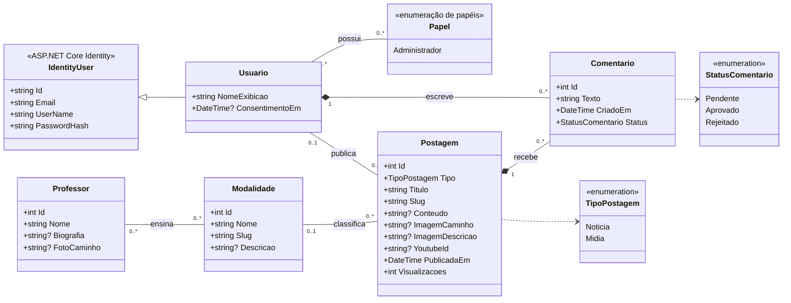

# Diagrama de classes

Modelo de domínio do blog Físico Combat, elaborado a partir dos requisitos da
Atividade Extensionista II (RF01–RF11). Fonte: `src/FisicoCombat.Web/Models/`.

## Regras representadas

| Relação | Regra |
|---|---|
| Professor ↔ Modalidade | Muitos para muitos: um professor ensina várias modalidades e uma modalidade tem vários professores. |
| Modalidade → Postagem | Opcional. Ao excluir uma modalidade, as postagens continuam, sem modalidade. |
| Usuario → Postagem | O administrador que publicou. Se a conta for excluída, a postagem continua. |
| Postagem ◆ Comentario | Composição: ao excluir a postagem, seus comentários são excluídos. |
| Usuario ◆ Comentario | Composição: ao excluir a conta (LGPD), os comentários do usuário são excluídos. |
| Comentario.Status | Todo comentário nasce `Pendente` e só aparece no blog depois de `Aprovado` pelo administrador. |
| Postagem.Tipo | `Midia` exige foto ou vídeo do YouTube; `Noticia` é texto com foto opcional. |

## Rastreabilidade dos requisitos

| Requisito | Classes |
|---|---|
| RF01 Login como administrador | Usuario, Papel (Administrador) |
| RF02, RF03 Professores | Professor |
| RF04, RF05 Modalidades | Modalidade |
| RF06 Postar mídia | Postagem (Tipo = Midia) |
| RF07 Postar notícia | Postagem (Tipo = Noticia) |
| RF08 Login como usuário comum | Usuario |
| RF09 Buscar mídia por modalidade | Postagem, Modalidade |
| RF10 Comentar na postagem | Comentario |
| RF11 Compartilhar postagem | Postagem (Slug, para o link) |
